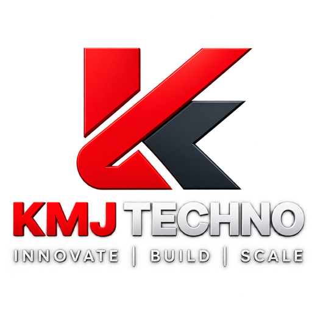

# KMJ CodeBridge for Claude

KMJ CodeBridge connects Claude to projects on computers and VPSs you explicitly
authorize. The public plugin uses KMJ TECHNO's OAuth-protected MCP endpoint at
`https://kmjtechno.com/mcp`; it contains no API key, bearer token, or device
credential.

## What this plugin contains

- One `codebridge` skill with the shared safety rules used across supported
  AI clients.
- One remote Streamable HTTP MCP server named `codebridge`.
- Branding, license, privacy, and terms files.

## Connect

Enable the plugin and choose **Connect**. Claude discovers the OAuth
authorization server from the MCP protected-resource metadata and opens the KMJ
account-linking flow. Only devices/projects authorized for that account are
exposed.

Claude Desktop installations using a third-party inference **Gateway** profile
manage remote MCP servers in **Inference configuration → Connectors**. In that
mode add `https://kmjtechno.com/mcp` as a Streamable HTTP server and use
OAuth auto-registration; the account-level plugin Connect control may be
unavailable in that deployment profile. If a previously working connector gets
stuck on `invalid_client`, re-add it and use a freshly registered public OAuth
client instead of retrying the stale registration. Leave the client secret
blank. Claude Desktop managed MCP may use an RFC 8252 loopback callback with an
ephemeral local port; the CodeBridge authorization server supports that
port-varying loopback behavior while keeping PKCE mandatory.

## Disabled Connect button in Claude Desktop

If Settings → Plugins → KMJ CodeBridge displays **"You're not connected to
codebridge yet"** with an inactive or nonresponsive **Connect** button, don't
assume the KMJ authorization service is down. Claude's plugin connection
screen and its account-level custom MCP connector registration may not activate
the same OAuth flow. Anthropic has received reports of similar disabled
plugin-level connection controls.

Use the Claude-supported **account connector** instead:

1. Open Claude **Customize → Connectors** (or **Settings → Connectors**
   in clients with the older navigation).
2. Choose **Add custom connector** and name it **KMJ CodeBridge**.
3. Set the **remote MCP URL** to `https://kmjtechno.com/mcp`.
4. Save, choose **Connect / Authenticate**, and authorize KMJ in the
   browser opened by Claude. Do not paste API keys or tokens into plugin
   JSON or chat.
5. Enable the connector in the chat connector picker and ask Claude to
   list the CodeBridge devices authorized for your account.

For Claude Desktop **third-party inference Gateway mode**, follow the
existing **Inference configuration → Connectors → Managed MCP servers**
procedure above instead of this account-level route.

**Read-only doctor:** from a checked-out CodeBridge source tree with Node 24+,
run `npm run doctor:claude`. It fetches only public resource and
authorization-server metadata, validates PKCE S256 and public client
registration, then returns `metadata: PASS | FAIL | UNVERIFIED`.
It deliberately does **not** click the Claude UI or prove a connected
account. A `GET /mcp` HTTP 405 response does not alone prove a broken
Streamable HTTP MCP endpoint; real MCP initialization is a protocol operation.

If the metadata passes but Claude's account connector cannot authorize,
record the Claude Desktop version, whether Gateway mode is enabled, whether
the browser confirmation dialog opened, and the visible OAuth error (without
sharing authorization codes, cookies or credentials). Client UI controls are
owned by Claude and cannot be force-enabled by editing the plugin manifest.

## Self-hosted deployments

The repository remains self-hostable. Operators who run their own gateway should
generate an endpoint-specific Claude package instead of editing this public
plugin:

`npm run package:claude -- https://YOUR-HOST/mcp`

For static bearer developer deployments use the documented `bearer-env`
mode; never embed a credential in a plugin archive.

## Data flow

Claude sends MCP tool calls to the configured CodeBridge gateway. CodeBridge
routes authorized work to the outbound device agent, which enforces project
scope, guarded writes, secret redaction, and administrator-defined quality
gates. Tool results return to the Claude conversation.

## Commercial terms

Plans and licensing are controlled by KMJ Main Platform. The plugin does not
silently create a subscription or place credentials in source control.

## License and policies

The plugin files are Apache-2.0 licensed. Hosted-service use is also subject to
`TERMS.md`, `PRIVACY.md`, and the policies published by KMJ TECHNO.
KMJ CodeBridge is not affiliated with or endorsed by Anthropic or OpenAI.
